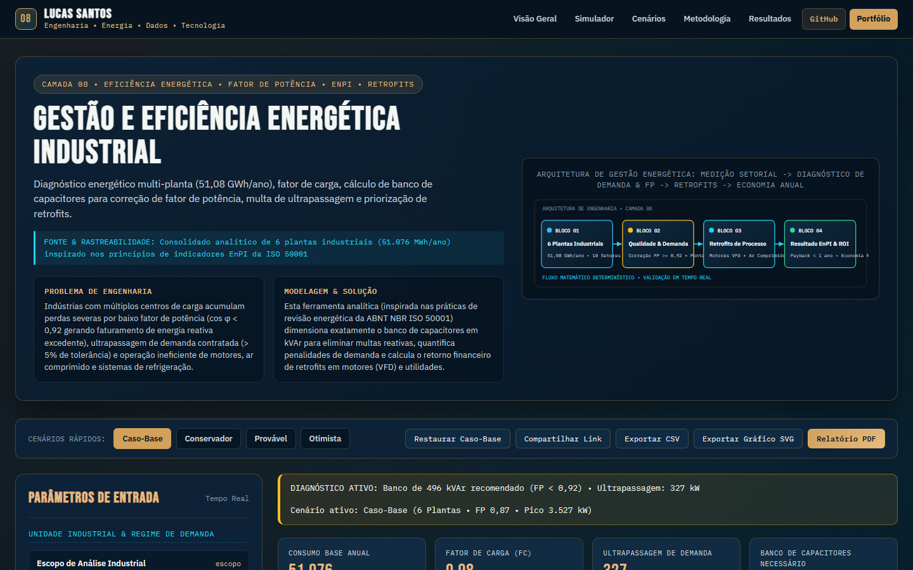

# Gestão e Eficiência Energética Industrial

> **Camada 08 do Ecossistema de Engenharia Interativa V3 • Eficiência Energética • Fator de Potência • EnPI • Retrofits**  
> Diagnóstico energético multi-planta (51,08 GWh/ano), fator de carga, cálculo de banco de capacitores para correção de fator de potência, multa de ultrapassagem e priorização de retrofits.

[](https://luscaarmstrong1.github.io/energy-management-dashboard/)
[](https://github.com/luscaarmstrong1/energy-management-dashboard)
[](https://luscaarmstrong1.github.io/energy-management-dashboard/)
[](https://lucassantos.eng.br/#arquitetura)
[](https://github.com/luscaarmstrong1/energy-management-dashboard)

---

## 1. Resumo Executivo

Este repositório integra o ecossistema de **Engenharia Interativa V3** de **Lucas Santos**, combinando modelagem física e técnico-econômica em Python com um **Simulador Web Interativo publicado no GitHub Pages** ([https://luscaarmstrong1.github.io/energy-management-dashboard/](https://luscaarmstrong1.github.io/energy-management-dashboard/)).

- **Rastreabilidade dos Dados e Modelo:** Consolidado analítico de 6 plantas industriais (51.076 MWh/ano) inspirado nos princípios de indicadores EnPI da ISO 50001.
- **Aplicação Web Autônoma:** Executa integralmente no navegador sem dependências externas frágeis, com validação de fronteira, comparador multicenário e exportação técnica (CSV, SVG e Relatório PDF).

---

## 2. Problema de Engenharia Abordado

Indústrias com múltiplos centros de carga acumulam perdas severas por baixo fator de potência (cos φ < 0,92 gerando faturamento de energia reativa excedente), ultrapassagem de demanda contratada (> 5% de tolerância) e operação ineficiente de motores, ar comprimido e sistemas de refrigeração.

---

## 3. Solução Proposta

Esta ferramenta analítica (inspirada nas práticas de revisão energética da ABNT NBR ISO 50001) dimensiona exatamente o banco de capacitores em kVAr para eliminar multas reativas, quantifica penalidades de demanda e calcula o retorno financeiro de retrofits em motores (VFD) e utilidades.

---

## 4. Funcionalidades Principais da Aplicação Interativa (V3)

1. **Painel Paramétrico Sincronizado (Slider + Input Numérico):** Controles duplos bidirecionais agrupados por domínio físico, operacional e econômico, com validação contra valores inválidos (`NaN`, `Infinity` ou fora de faixa).
2. **Motor Matemático Determinístico Auditado:** Recálculo instantâneo de todos os indicadores-chave (KPIs), balanços energéticos e séries temporais/financeiras.
3. **Múltiplas Visualizações Gráficas em Alta Nitidez (SVG):** Abas dedicadas com gráficos vetoriais responsivos e tooltips informativos.
4. **Comparador Multicenário Lado a Lado:** Comparação simultânea entre **Caso-Base**, **Conservador**, **Provável**, **Otimista** e a **Simulação Atual** do usuário.
5. **Diagnóstico Técnico Automatizado:** Geração dinâmica de alertas operacionais e recomendações de engenharia conforme os parâmetros configurados.
6. **Exportação e Compartilhamento:**
   - **Compartilhar Link:** Codifica todos os parâmetros na URL (`?param=valor`) para reprodutibilidade exata.
   - **Exportar CSV:** Download imediato da tabela de memória de cálculo.
   - **Exportar Gráfico SVG:** Download vetorial do gráfico ativo.
   - **Relatório PDF:** Folha de estilo dedicada para impressão técnica.

---

## 5. Demonstração Visual (Captura Real V3)



- **Acesse o Simulador Interativo:** [https://luscaarmstrong1.github.io/energy-management-dashboard/](https://luscaarmstrong1.github.io/energy-management-dashboard/)
- **Voltar à Seção #arquitetura no Portfólio:** [https://lucassantos.eng.br/#arquitetura](https://lucassantos.eng.br/#arquitetura)

---

## 6. Arquitetura Técnica e Fluxo de Dados

```text
[Parâmetros do Usuário / Presets de Cenário]
                 │
                 ▼
[Validação de Fronteira & Normalização Física]
                 │
                 ▼
[Motor Matemático Determinístico (Python & JS Engine V3)]
                 │
     ┌───────────┼───────────┐
     ▼           ▼           ▼
[KPI Cards] [Gráficos SVG] [Matriz Multicenário & Exportação CSV/PDF]
```

---

## 7. Metodologia e Equações Governantes

### 9.1. Dimensionamento de Banco de Capacitores para Correção do Fator de Potência

```text
Q_cap (kVAr) = P_ativa (kW) * [ tan( arccos(φ_atual) ) - tan( arccos(0,92) ) ]
```

Calcula a potência reativa capacitiva exata para elevar o fator de potência da instalação até o limite regulatório de 0,92 (ANEEL).

### 9.2. Fator de Carga Industrial e Penalidade de Ultrapassagem

```text
FC = E_mensal / (D_max * Horas_mes)   |   Multa_Demanda se D_medida > 1,05 * D_contratada
```

Nota técnica: este painel aplica conceitos de linha de base e EnPI inspirados na ISO 50001 como ferramenta analítica de engenharia, não constituindo certificação formal.

---

## 8. Premissas e Limitações do Modelo

- **Escopo Analítico:** Os resultados constituem estudos preliminares de engenharia e viabilidade técnico-econômica. Projetos executivos requerem medições locais de campanha, estudos de curto-circuito/coordenação de proteção e parecer formal da concessionária ou ONS/CCEE.
- **Conservação Física:** Nenhuma eficiência excede 100%, nenhum despacho de bateria viola `[SOC_min, SOC_max]` e todas as séries respeitam limites físicos estritos.

---

## 9. Parâmetros de Entrada e Faixas Aceitas

| Parâmetro | Unidade | Faixa Permitida | Valor Padrão | Descrição Técnica |
|---|---|---|---|---|
| **Escopo de Análise Industrial** (`unidade`) | escopo | consolidado / planta_unica | `consolidado` | Seleciona o portfólio industrial completo ou uma planta individual. |
| **Demanda Contratada na Concessionária** (`demandaContratadaKw`) | kW | [300 a 12000] | `3200` | Demanda registrada no contrato de fornecimento (CUSD). |
| **Demanda Máxima Medida** (`demandaMedidaPicoKw`) | kW | [300 a 14000] | `3527` | Pico de demanda integralizado em 15 minutos. |
| **Horas Operacionais no Mês** (`horasOperacaoMes`) | h/mês | [200 a 730] | `620` | Regime mensal de turnos produtivos para cálculo do Fator de Carga. |
| **Fator de Potência Médio Medido (cos φ)** (`fatorPotenciaAtual`) | adim. | [0.7 a 0.99] | `0.87` | Valores abaixo de 0,92 geram cobrança regulatória de UFER/DMCR. |
| **Custo Médio Ponderado da Energia** (`tarifaMediaKwh`) | R$/kWh | [0.45 a 2.2] | `1.07` | Tarifa média global da unidade industrial. |
| **Ganho com Inversores VFD & Motores IR4** (`eficMotoresVfdPct`) | % | [0 a 25] | `12` | Redução percentual no consumo do setor de força motriz e bombeamento. |
| **Ganho em Ar Comprimido & Refrigeração** (`eficHvacArPct`) | % | [0 a 30] | `15` | Eliminação de vazamentos pneumáticos e otimização de chillers. |
| **CAPEX Total do Pacote de Eficiência** (`investimentoRetrofitM`) | R$ mi | [0.2 a 20] | `3.75` | Investimento em bancos de capacitores, VFDs, motores e automação. |

---

## 10. Indicadores de Saída (KPIs Explicados)

| Indicador (KPI) | Unidade | Interpretação de Engenharia |
|---|---|---|
| **Consumo Base Anual** (`annualConsumptionMwh`) | MWh/ano | Linha de base energética das plantas |
| **Fator de Carga (FC)** (`loadFactor`) | adim. | Razão demanda média / demanda máxima |
| **Ultrapassagem de Demanda** (`exceedanceKw`) | kW | Parcela acima da demanda contratada |
| **Banco de Capacitores Necessário** (`capacitorBankKvar`) | kVAr | Potência reativa para elevar cos φ a 0,92 |
| **Multa Reativa Evitável** (`annualReactivePenaltyBrl`) | R$/ano | Custo anual por baixo fator de potência |
| **Energia Economizada (Retrofits)** (`savingsMwhYear`) | MWh/ano | Redução física de consumo ativo |
| **Economia Anual Total** (`totalAnnualSavingsBrl`) | R$/ano | Eficiência + Eliminação de Multas |
| **Payback do Programa** (`paybackYrs`) | anos | Tempo de retorno sobre o CAPEX investido |

---

## 11. Estrutura de Diretórios do Repositório

```text
energy-management-dashboard/
├── docs/                       # Aplicação Web Interativa V3 (GitHub Pages)
│   ├── index.html              # Interface completa com esquemático SVG e seções técnicas
│   ├── simulator.css           # Design System Dark Technical Navy + Copper Gold V3
│   ├── simulator.js            # Motor matemático JS auditado + renderizador gráfico SVG
│   └── assets/
│       └── v3-preview.png      # Captura real da interface V3 em 1440x900
├── src/                        # Módulos Python de engenharia, simulação e pipeline de dados
├── data/                       # Datasets de referência, séries curadas e saídas analíticas
├── tests/                      # Testes automatizados de consistência matemática
└── README.md                   # Documentação técnica completa (18 seções)
```

---

## 12. Como Executar Localmente

### 12.1. Simulador Web Interativo (Zero Dependências)

```bash
git clone https://github.com/luscaarmstrong1/energy-management-dashboard.git
cd energy-management-dashboard
npx serve docs
```

Ou abra `docs/index.html` em qualquer servidor HTTP estático local.

### 12.2. Pipeline Analítico em Python

```bash
python -m venv .venv
.venv\Scripts\activate
pip install -r requirements.txt
pytest
```

---

## 13. Como Executar os Testes Automatizados

- **Validação Matemática e de Fronteira:** Verifica ausência de `NaN`/`Infinity`, conservação de energia, monotonia econômica e casos analíticos de referência.
- **Validação E2E e Responsiva (Playwright):** Verifica 0 erros de console, atualização dinâmica de KPIs e gráficos e 0px de overflow horizontal em `320x568`, `390x844`, `768x1024`, `1024x768` e `1440x900`.

---

## 14. Casos de Uso Práticos

1. **Estudos Preliminares de Engenharia e Propostas Técnicas:** Avaliação rápida de sensibilidade junto a clientes industriais e comerciais.
2. **Auditoria de Premissas Técnico-Econômicas:** Comparação transparente entre cenários conservadores, prováveis e otimistas.
3. **Demonstração de Competência Multidisciplinar:** Integração real entre engenharia elétrica, regulação, ciência de dados e desenvolvimento full-stack.

---

## 15. Próximas Evoluções Técnicas

- Integração via API REST com séries meteorológicas INMET/NSRDB e dados horários CCEE/ONS em tempo real.
- Otimização estocástica via Monte Carlo para quantificação de VaR (Value at Risk) energético.

---

## 16. Autor e Contato Profissional

**Lucas Santos**  
*Engenheiro Eletricista • Sistemas de Potência, Energias Renováveis, Dados & Software*

- **Portfólio Principal:** [https://lucassantos.eng.br](https://lucassantos.eng.br)
- **Seção de Engenharia Interativa:** [https://lucassantos.eng.br/#arquitetura](https://lucassantos.eng.br/#arquitetura)
- **GitHub:** [https://github.com/luscaarmstrong1](https://github.com/luscaarmstrong1)
