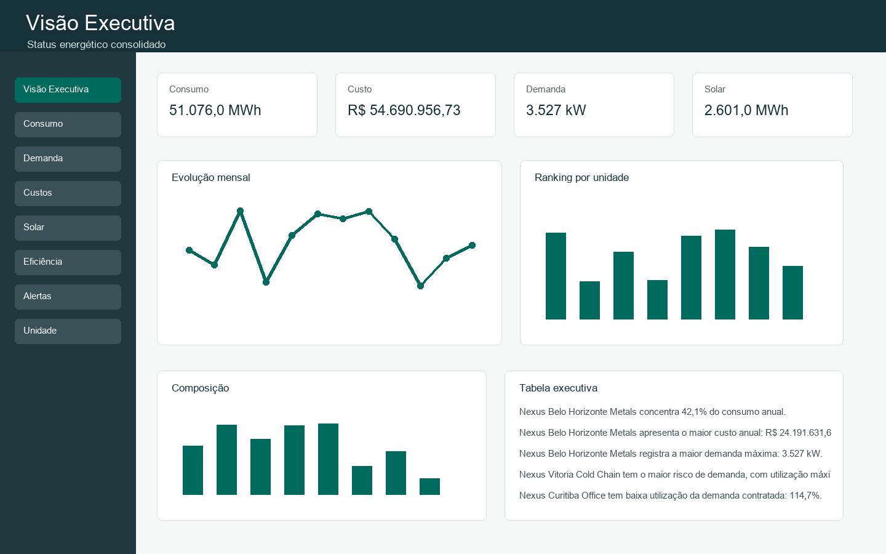
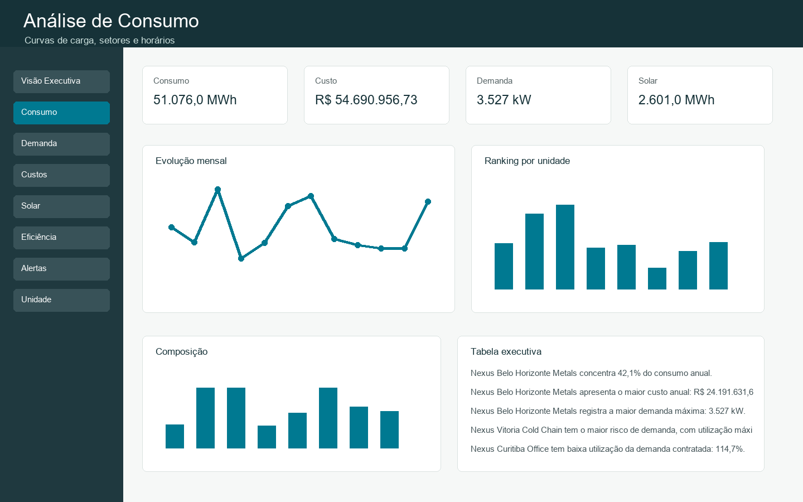
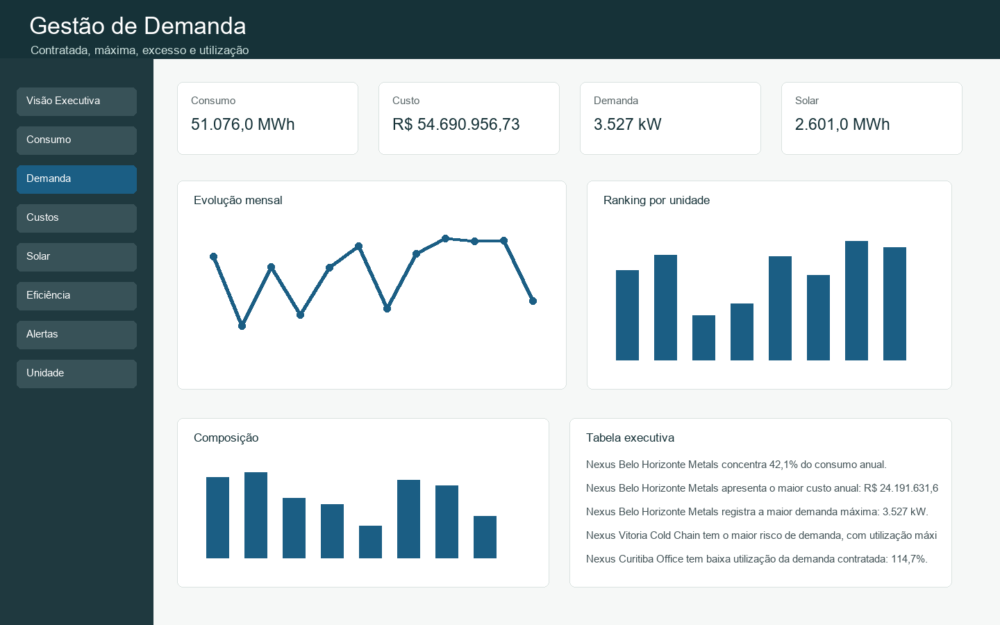
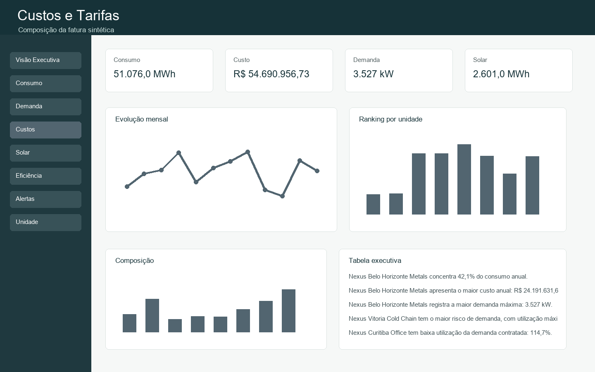

# Dashboard de Gestão e Eficiência Energética Industrial
### *Industrial Energy Management & Efficiency Dashboard*

[](https://luscaarmstrong1.github.io/energy-management-dashboard/)
[](https://lucas-santos-portfolio-zeta.vercel.app/)
[](https://www.linkedin.com/in/lucasssantos1/)
[](https://github.com/luscaarmstrong1/energy-management-dashboard)

> **Camada 08 • Ecossistema de Engenharia, Energia, Dados & Automação**
> Monitoramento multi-unidade de consumo, demanda contratada (ponta/fora de ponta), fator de potência, geração solar própria, baseline energético e alertas.

---

## Acesse o Simulador Interativo e Demonstração Online

- **Simulador Paramétrico Web (GitHub Pages):** [https://luscaarmstrong1.github.io/energy-management-dashboard/](https://luscaarmstrong1.github.io/energy-management-dashboard/)
- **Vitrine no Portfólio Principal:** [https://lucas-santos-portfolio-zeta.vercel.app/#arquitetura](https://lucas-santos-portfolio-zeta.vercel.app/#arquitetura)

---

## Visão Geral e Problema de Engenharia

Plataforma analítica de gestão energética industrial (ISO 50001): monitoramento de consumo e demanda na ponta, controle de ultrapassagem e fator de potência, geração fotovoltaica on-site e diagnóstico de eficiência em Python e Streamlit.

### Indicadores-Chave do Projeto (Caso-Base)

| Indicador Técnico | Resultado / Escopo | Detalhamento de Engenharia |
| :--- | :--- | :--- |
| **Escopo Operacional** | `8 Módulos` | Consumo, Demanda, Custos, Solar e Alertas |
| **Gestão de Demanda** | `Ponta & Fora` | Prevenção de ultrapassagem tarifária |
| **Geração On-Site** | `Autoconsumo FV` | Abatimento direto no horário de ponta |
| **Diagnóstico Ativo** | `Baseline EnPI` | Detecção de desvios de intensidade energética |

---

## Arquitetura do Sistema e Fluxo de Modelagem

1. **Etapa 01:** Consolidação de Medições Multi-Planta (Séries horárias de consumo ativo, demanda kW, geração solar e produção)
2. **Etapa 02:** Análise Tarifária e Gestão de Demanda (Avaliação de ponta/fora de ponta, ultrapassagem e oportunidade de ajuste contratual)
3. **Etapa 03:** Rastreamento de Eficiência & Baseline (Comparação do consumo real contra linha de base ajustada por produção e clima)
4. **Etapa 04:** Motor de Alertas e Plano de Ação (Identificação automática de anomalias de fim de semana, picos e retorno de retrofits)

---

## Fundamentação Física, Matemática e Regulatória

### 1. Indicador de Intensidade Energética (EnPI)
```text
EnPI = Consumo_Total_Energia(kWh) / Volume_Produção_Industrial(unid)
```

### 2. Penalidade de Ultrapassagem de Demanda
```text
C_Ultrapassagem = (D_Medida - D_Contratada) · 2 · Tarifa_Demanda  [se D_Medida > 1,05 · D_Contratada]
```

### 3. Economia Integrada (Solar + Eficiência)
```text
Economia_Anual = E_Solar_Autoconsumo · Tarifa_Média + ΔE_Eficiência · Tarifa_Ponta_FP
```

---

## Painéis Analíticos e Evidências Visuais

### Visão Executiva de Gestão Energética Industrial


### Perfil de Consumo Horário e Sazonalidade


### Gestão de Demanda Contratada vs. Medida


### Decomposição de Custos Tarifários Ponta / Fora Ponta


---

## Como Executar Localmente

```bash
# 1. Clone o repositório
git clone https://github.com/luscaarmstrong1/energy-management-dashboard.git
cd energy-management-dashboard

# 2. Instale as dependências e execute a suíte analítica
pip install -r requirements.txt
pytest
streamlit run app.py
```

> **Nota Técnica:** Este projeto utiliza modelagem determinística auditável e séries sintéticas estruturadas para demonstração de arquitetura de engenharia elétrica, ciência de dados e tomada de decisão técnico-econômica. Não substitui projeto executivo, parecer de acesso da concessionária ou emissão de ART específica de campo.

---

## Autor e Responsável Técnico

**Lucas Silva Santos**
*Engenheiro Eletricista & Gerente de Projetos*
Energia • Dados • Inteligência Artificial • Automação • São João da Boa Vista, SP • Itajubá, MG

- **Portfólio:** [https://lucas-santos-portfolio-zeta.vercel.app/](https://lucas-santos-portfolio-zeta.vercel.app/)
- **LinkedIn:** [linkedin.com/in/lucasssantos1](https://www.linkedin.com/in/lucasssantos1/)
- **GitHub:** [@luscaarmstrong1](https://github.com/luscaarmstrong1)
